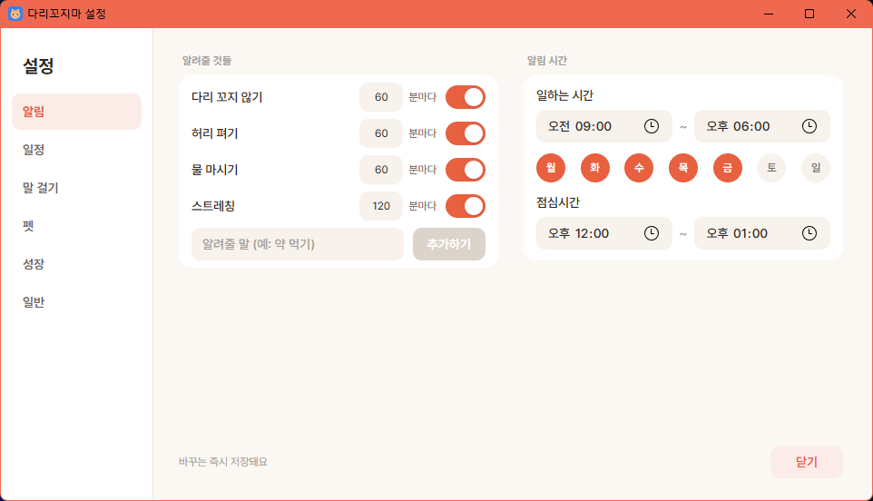
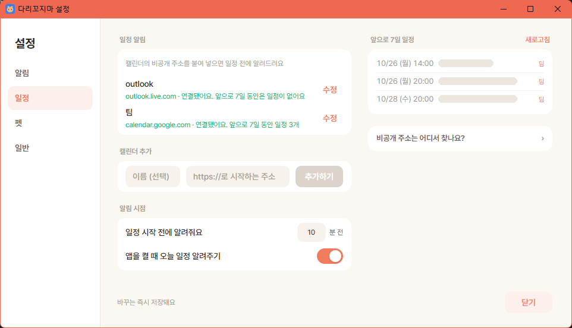
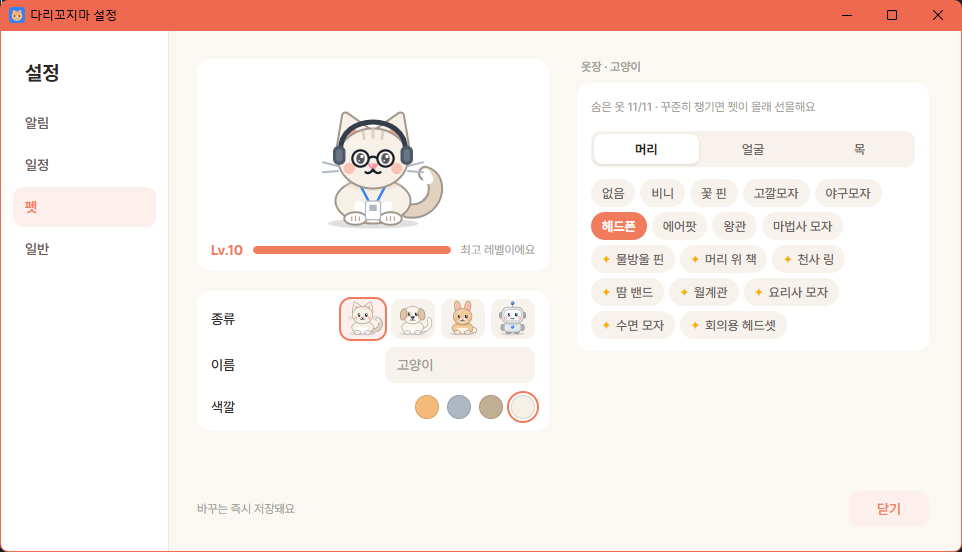
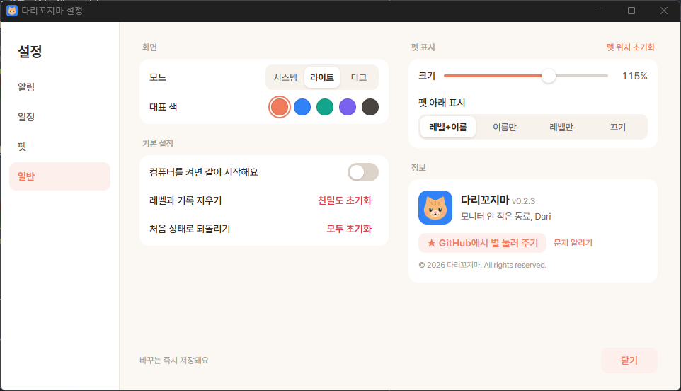

# 다리꼬지마

바탕화면에 사는 작은 펫이 "다리 또 꼬셨죠?", "물 한 잔 하고 오세요" 같은 잔소리를 합니다. 자세, 물 마시기, 스트레칭, 일정을 챙겨 주는 Windows 앱입니다.

- 고양이, 강아지, 토끼, AI봇 중에 고를 수 있고, 이름·색깔·크기도 바꿀 수 있습니다.
- 근무 시간 외, 점심시간, 전체화면(발표·영상·게임) 중에는 조용히 있습니다.
- 구글·아웃룩 같은 캘린더를 연결하면 회의 30분 전에 알려 줍니다.
- 사용자 PC 밖으로 보내는 정보는 없습니다. 설정은 이 PC에만 저장하며, 외부 요청은 연결한 캘린더 주소와 업데이트 확인뿐입니다.

## 설치하기

Windows 10/11 (64비트)에서 사용할 수 있습니다. 관리자 권한은 필요하지 않습니다. Mac은 아래 "Mac" 안내를 참고하십시오.

1. [Releases](https://github.com/letsgojh0810/darikkojima/releases) 페이지에서 가장 위에 있는 버전의 `darikkojima_x.y.z_x64-setup.exe`를 내려받습니다.
2. 내려받은 파일을 실행합니다. 설치 마법사는 한국어이며, "다음"만 누르면 됩니다.
3. 설치가 끝나면 바탕화면에 펫이 나타납니다.

### "Windows의 PC 보호" 창이 뜨면

아직 코드 서명을 받지 않은 앱이라, 처음 실행할 때 파란 경고창이 뜰 수 있습니다.

1. 창 안의 **추가 정보**를 누릅니다.
2. 아래에 생긴 **실행**을 누릅니다.

### Mac (Apple Silicon, 시험 중)

1. Releases에서 `darikkojima_x.y.z_aarch64.dmg`를 내려받아 열고, 앱을 **응용 프로그램** 폴더로 끌어다 놓습니다.
2. 아직 Apple 서명을 받지 않은 앱이라, 처음 열면 "확인되지 않은 개발자" 경고가 뜹니다.
3. **시스템 설정 → 개인정보 보호 및 보안**으로 가서 맨 아래 **그래도 열기**를 누르고, 한 번 더 **열기**를 누릅니다.
4. 펫은 화면 위 메뉴 막대의 아이콘에서 설정할 수 있습니다 (Dock에는 나오지 않습니다). 업데이트는 Windows와 같이 자동으로 이루어집니다.

Mac에서는 아직 전체화면 앱을 감지하지 않아서, 발표 중에도 말을 걸 수 있습니다. 그럴 때는 **조용히 하기**를 켜십시오.

Intel Mac과 Linux는 아직 지원하지 않습니다.

## 처음 쓰는 법

설치하면 기본 설정으로 바로 알림을 시작합니다. 평일 오전 9시부터 오후 6시까지 알려 주고, 점심시간(낮 12시부터 오후 1시까지)에는 쉽니다.

| 하고 싶은 것 | 방법 |
|---|---|
| 펫 옮기기 | 펫을 끌어서 놓습니다. 끌고 가는 동안 펫이 달려가거나 헤엄치고, 놓은 자리는 다음에 켜도 그대로입니다. 화면 밖으로 너무 밀면 싫다며 돌아오지만, 한 번 더 밀면 따라 줍니다. |
| 펫과 놀기 | 마우스를 올리면 웃고, 클릭하면 한마디를 합니다. 꾹 누르고 있으면 버둥거립니다. |
| 펫 재우기 | 키보드와 마우스를 10분 넘게 쓰지 않으면 펫이 엎드려 잠듭니다. 돌아와서 움직이면 깹니다. |
| 알림에 답하기 | 말풍선의 **했어요**를 누르면 닫힙니다. **5분 뒤에 다시**는 5분 뒤에 한 번 더 알려 주고, **오늘은 그만**은 그 알림만 내일까지 끕니다. |
| 설정 열기 | 펫을 오른쪽 클릭하거나, 작업표시줄 오른쪽 아래(숨겨진 아이콘 포함) 트레이 아이콘의 **설정**을 누릅니다. |
| 조용히 하기 | 펫 우클릭 → **조용히 하기**. 펫 입에 X자 테이프가 붙고, **다시 말 걸기**를 누를 때까지 말을 걸지 않습니다. 트레이 메뉴에도 있습니다. |
| 부탁하기 | 펫 우클릭 → **부탁하기** → **점심 메뉴 추천**, **퇴근까지 얼마나 남았어?**, **오늘 일정 알려줘**, **다음 주 일정 알려줘**. |
| 펫 숨기기 | 트레이 아이콘 → **펫 숨기기**. 다시 보려면 **펫 보이기**를 누릅니다. |
| 끄기 | 펫 우클릭 → **종료**. |

앱은 하나만 실행됩니다. 숨겨 둔 펫은 앱을 한 번 더 실행해도 다시 나옵니다.

## 펫이 먼저 말을 겁니다

찾지 않아도 정해진 때에 펫이 먼저 한마디 합니다. 대답하지 않으면 인사는 **1분**, 알림은 **3분** 뒤에 저절로 사라집니다. 알림이 여러 개 오면 한 말풍선에 모아서(최대 3줄) 보여 줍니다. 그래서 자리를 비운 사이에 말풍선이 쌓이는 일은 없습니다.

| 언제 | 무슨 말 |
|---|---|
| 앱을 켰을 때 | 시간대에 맞는 인사. 캘린더를 연결했다면 오늘 첫 일정도 알려 줍니다. |
| 점심시간 30분 전 | "점심 뭐 먹을까요?"라는 말풍선에 **추천해 줘요** 버튼이 뜹니다. 누르면 메뉴를 골라 주고, 마음에 안 들면 **다시**를 누릅니다. |
| 퇴근 3시간 전, 1시간 전 | "퇴근까지 1시간이에요" |
| 퇴근 5분 전 | "오늘도 수고했어요" (금요일은 주말 인사) |
| 근무 중 가끔 (35~80분마다) | "심심하네요… 바쁘신가요?" |

**조용히 하기**를 켜 두었거나 전체화면 앱을 사용하는 중에는 말을 걸지 않습니다.

## 설정하기

설정 창은 왼쪽 메뉴의 **알림**, **일정**, **펫**, **일반** 네 탭으로 구성됩니다. 바꾸는 즉시 저장되고 펫에도 바로 반영되므로, 다 바꾼 뒤에는 **닫기**만 누르면 됩니다.

**알림 탭**
- **알려줄 것들:** 다리 꼬지 않기, 허리 펴기, 물 마시기, 스트레칭을 켜고 끄고, 몇 분마다 알려 줄지 정합니다. 아래 입력창에 "약 먹기"처럼 쓰고 **추가하기**를 누르면 내가 만든 알림도 넣을 수 있습니다.
- **펫이 먼저 말 걸기:** 켤 때 인사, 점심 메뉴 추천, 퇴근 카운트다운, 퇴근 인사, 심심할 때 수다를 눌러서 켜고 끕니다. 마우스를 올리면 자세한 설명이 보입니다.
- **알림 시간:** 일하는 시간, 요일, 점심시간을 정합니다. 이 밖의 시간에는 알리지 않습니다.
- **점심 메뉴:** **수정**을 누르면 룰렛에 나오는 메뉴를 추가하거나 지울 수 있습니다.



**일정 탭**
- 캘린더 주소를 이름과 함께 추가하고(예: 내 캘린더, 팀 캘린더), 일정 몇 분 전에 알려 줄지 정합니다. (아래 "캘린더 연결하기")
- 추가한 캘린더는 연결 상태와 앞으로 7일 일정이 바로 보입니다. 캘린더에 일정을 새로 넣었다면 **새로고침**을 누릅니다.
- **앱을 켤 때 오늘 일정 알려주기**를 켜 두면, 앱을 켤 때 오늘 남은 일정을 목록으로 말해 줍니다.



**펫 탭**
- **미리보기:** 지금 입은 옷 그대로 펫이 보이고, 아래에 친밀도 레벨이 있습니다. 알림에 **했어요**를 누르거나, 펫을 쓰다듬거나, 인사를 받으면 친해집니다. 보통 일주일쯤이면 최고 레벨(Lv.10)이 되고, 레벨이 오를수록 말투가 편해지고 하는 말도 늘어납니다.
- **종류, 이름, 색깔:** 고양이, 강아지, 토끼, AI봇 중에 고르고, 펫마다 이름과 색깔(4가지)을 정합니다.
- **옷장:** 펫마다 머리, 얼굴, 목에 옷을 입힙니다. Lv.1, 3, 5, 10에 아홉 벌씩 열리고, 미리보기에서 입은 모습을 바로 볼 수 있습니다.
- **숨은 옷:** **히든** 표시가 붙은 옷은 꾸준히 챙기다 보면 펫이 깜짝 선물로 줍니다. 마우스를 올리면 힌트가 보입니다.



**일반 탭**
- **화면:** 라이트/다크(또는 Windows 설정 따라가기)와 대표 색(코랄, 블루, 민트, 라벤더, 차콜)을 고릅니다.
- **펫 표시:** 펫 크기(50%~150%)와 펫 아래에 레벨·이름을 보일지 정합니다. 펫이 안 보이면 **펫 위치 초기화**를 누릅니다.
- **기본 설정:** 컴퓨터를 켜면 같이 시작할지 정합니다. **친밀도 초기화**는 레벨과 기록, 받은 숨은 옷을 되돌리고, **모두 초기화**는 모든 설정을 처음 상태로 되돌립니다. 둘 다 되돌릴 수 없습니다.
- **정보:** 앱 버전과 GitHub 링크를 볼 수 있습니다.



## 캘린더 연결하기

캘린더의 **비공개 주소(iCal)**를 붙여 넣으면 됩니다. 로그인 정보는 필요하지 않습니다. 비공개 주소는 비밀번호처럼 다뤄야 하므로 다른 사람에게 보여 주지 마십시오. 설정 창에는 주소의 앞부분(호스트)만 보입니다.

- **구글 캘린더 (PC 웹):** 오른쪽 위 톱니바퀴 → **설정** → 왼쪽 **내 캘린더의 설정**에서 원하는 캘린더 선택 → **캘린더 통합** → "iCal 형식의 비공개 주소"를 복사합니다.
- **아웃룩:** 오른쪽 위 톱니바퀴(설정) → **일정** → **공유 일정** → **일정 게시**에서 캘린더를 고르고 "모든 세부 정보 보기 가능"으로 게시한 뒤, **ICS** 링크를 복사합니다.
  - "시간만 보기"로 게시하면 일정 제목 대신 '바쁨'처럼 보입니다.
  - 회사 계정은 관리자가 게시를 막아 두었을 수 있습니다.
- 주소는 캘린더마다 다릅니다. 같은 구글·아웃룩 계정이라도 내 캘린더, 팀 캘린더처럼 나뉘어 있으면 하나씩 추가해 주십시오. 추가할 때 이름을 붙여 두면 구분하기 쉽습니다.
- 메뉴 이름은 서비스가 바뀌면 달라질 수 있습니다.

복사한 주소는 설정 → **일정** 탭의 **캘린더 추가**에 붙여 넣고 **추가하기**를 누릅니다. 앱이 바로 연결을 확인하며, 그 뒤로는 15분마다 새로 불러옵니다.

## 이럴 땐 알림이 오지 않습니다

- 일하는 시간이 아닌 시간, 점심시간, 선택하지 않은 요일
- 발표·영상·게임 같은 전체화면 앱을 사용하는 동안
- 자리를 비운 동안 (키보드·마우스를 10분 넘게 쓰지 않았거나 화면을 잠갔을 때). 돌아오면 밀린 알림을 한꺼번에 보내지 않고, 그때부터 다시 셉니다. (Windows만)
- 회의 일정이 진행 중인 동안 (자세 알림만 해당하며, 일정 알림은 정상적으로 옵니다)
- **조용히 하기**를 켜 둔 동안 (펫 입에 X자 테이프가 붙어 있습니다)
- 그 알림을 꺼 둔 동안 (설정의 스위치, 또는 말풍선에서 **오늘은 그만**)

## 업데이트와 삭제

- **업데이트:** 앱이 켜져 있는 동안 6시간마다 새 버전을 확인해서 자동으로 설치합니다.
- **삭제:** Windows 설정 → 앱 → 설치된 앱 → **다리꼬지마** → 제거
- **설정 초기화:** 설정 → **일반** 탭의 **모두 초기화**를 누릅니다. 설정이 두 파일(`settings.json`, `settings.backup.json`)에 이중으로 저장되므로, 파일을 직접 지우는 방법은 쓰지 않습니다.

## 문제가 있을 때

| 증상 | 확인할 내용 |
|---|---|
| 펫이 보이지 않습니다 | 트레이 아이콘(숨겨진 아이콘 포함) → **펫 보이기**. 그래도 없으면 앱을 한 번 더 실행합니다. |
| 알림이 오지 않습니다 | 위의 "이럴 땐 알림이 오지 않습니다"를 확인합니다. |
| 일정 알림이 오지 않습니다 | 주소가 `https://`로 시작하는지, 캘린더에서 "비공개 주소"를 복사했는지 확인합니다. |
| 펫이 구석에 박혔거나 화면 밖으로 사라졌습니다 | 트레이 아이콘 → **펫 위치 초기화**. 주 모니터 오른쪽 아래로 돌아옵니다 (설정 → 펫 탭에도 있습니다). |

---

# 개발자용

## 개발 환경

필요한 것:

| 도구 | 비고 |
|---|---|
| Node.js 22 이상 | |
| Rust (stable) | [rustup](https://rustup.rs) |
| Visual Studio Build Tools | "C++를 사용한 데스크톱 개발" 워크로드 |
| WebView2 런타임 | Windows 11은 기본 포함 |

```powershell
npm install
npm run app            # 개발 실행: 설치한 앱과 따로 com.darikkojima.dev 이름으로 데이터를 쓰고, 자동 업데이트도 하지 않습니다
npm test               # 단위 테스트 (vitest)
npm run tauri build    # 설치 파일 빌드 (아래 서명 키 필요)
```

구조:

```
src/scheduler   리마인더 스케줄러(기본 + 사용자 정의)와 방해 금지 판정(rules.ts, 순수 함수)
src/calendar    CalendarSource 인터페이스, ICS 구현, 일정 알림
src/pet         펫 UI. anim/pets.ts의 목록에서 펫을 고르고, 펫 컴포넌트는 PetAnimation 인터페이스 뒤에 있습니다
src/native      Rust 커맨드 호출 래퍼
src/messages    한국어 문구(ko.ts), 펫별 클릭 문구 포함
src/store       설정 스키마와 저장소
src/tokens.css  디자인 토큰(크림·코랄 색), 라이트/다크 모드
src-tauri       창, 트레이, 전체화면 감지(Win32), 플러그인 등록
```

성능 목표: 유휴 시 프라이빗 메모리 약 180MB 이하, CPU 1% 미만(작업 관리자 전체 기준). 릴리스 빌드 실측은 메모리 약 170MB, CPU 약 0.1%입니다(펫 추가·드래그 동작 이전 측정). WebView2 특성상 100MB 미만은 어렵습니다.

## 릴리스

### 1. 업데이트 서명 키 만들기 (최초 1회)

자동 업데이트는 서명된 파일만 설치합니다. 키는 한 번만 만들고, **개인키는 저장소에 올리지 마십시오.** 잃어버리면 기존 사용자에게 업데이트를 보낼 수 없습니다.

```powershell
npx tauri signer generate -w $env:USERPROFILE\.tauri\darikkojima.key
```

- 비밀번호를 물어보면 입력합니다(비워도 되지만 권장하지 않습니다).
- `darikkojima.key`(개인키)와 `darikkojima.key.pub`(공개키)가 생깁니다.
- 공개키 내용을 `src-tauri/tauri.conf.json`의 `plugins.updater.pubkey`에 넣습니다. 이미 들어 있는 값은 이 저장소의 키이므로, 키를 새로 만들면 교체해야 합니다.

### 2. GitHub Secrets 등록

저장소의 **Settings → Secrets and variables → Actions → New repository secret**에서 두 개를 추가합니다.

| 이름 | 값 |
|---|---|
| `TAURI_SIGNING_PRIVATE_KEY` | `darikkojima.key` 파일의 **내용 전체** |
| `TAURI_SIGNING_PRIVATE_KEY_PASSWORD` | 키 비밀번호 (비밀번호가 없으면 등록하지 않아도 됩니다) |

CLI로 등록하려면:

```powershell
Get-Content $env:USERPROFILE\.tauri\darikkojima.key -Raw | gh secret set TAURI_SIGNING_PRIVATE_KEY
gh secret set TAURI_SIGNING_PRIVATE_KEY_PASSWORD   # 비밀번호가 없으면 이 줄은 건너뜁니다
```

### 3. 버전을 올리고 태그 push

```powershell
# package.json, src-tauri/tauri.conf.json, src-tauri/Cargo.toml, src-tauri/Cargo.lock(name = "darikkojima" 항목)의 version을 같은 값으로 올립니다
git commit -am "chore: v0.1.2"
git tag v0.1.2
git push origin main v0.1.2
```

`v*` 태그를 push하면 `.github/workflows/release.yml`이 windows-latest에서 테스트 후 빌드하고, **draft** 릴리스에 `setup.exe`, `.sig`, `latest.json`을 올립니다.

### 4. 릴리스 게시

GitHub의 Releases에서 draft를 확인하고 **Publish release**를 누릅니다. 게시해야 앱이 `latest.json`을 읽고 업데이트합니다.

> 업데이트 확인(`releases/latest/download/latest.json`)과 설치 파일 다운로드는 로그인 없이 접근할 수 있어야 하므로, 사용자에게 배포할 때는 저장소를 public으로 두어야 합니다.

### 로컬에서 설치 파일 빌드

```powershell
$env:TAURI_SIGNING_PRIVATE_KEY = "$env:USERPROFILE\.tauri\darikkojima.key"
$env:TAURI_SIGNING_PRIVATE_KEY_PASSWORD = ""   # 키 비밀번호
npm run tauri build
# 결과: src-tauri\target\release\bundle\nsis\darikkojima_<버전>_x64-setup.exe
```

## 범위 외

웹캠 자세 감지, Intel Mac·Linux, OAuth 캘린더(Google, MS Graph), 네이버웍스/카카오 연동, 코드 서명.
